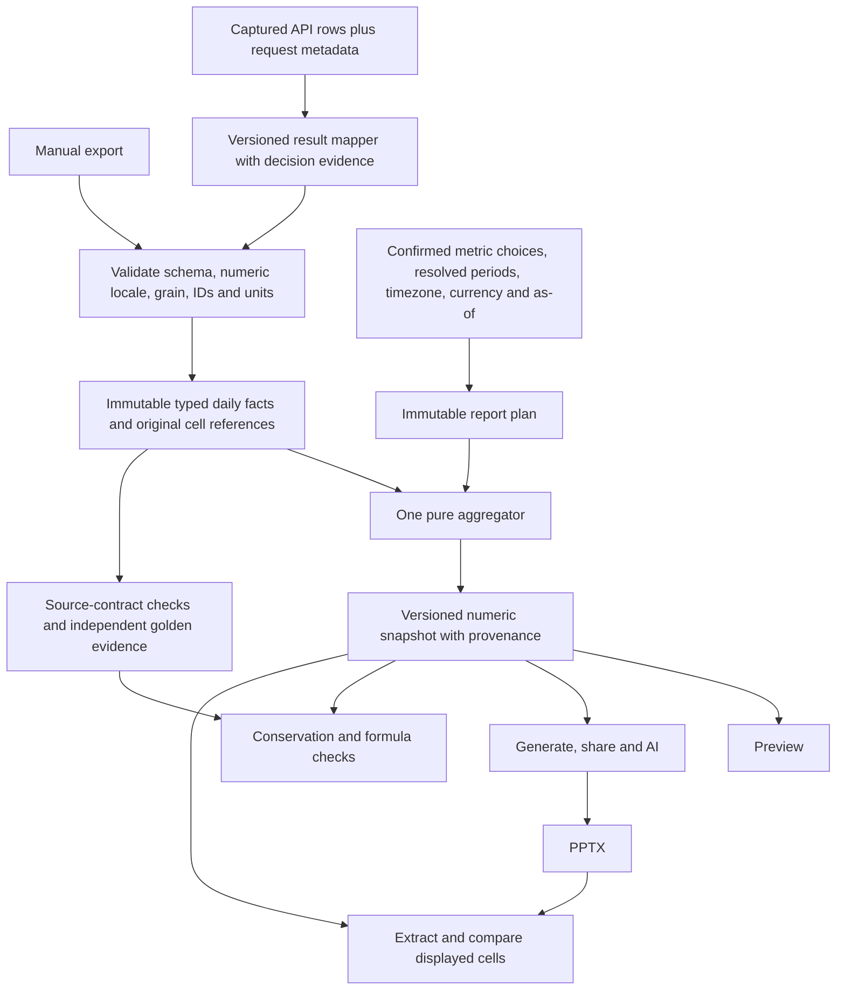

# NRE accuracy audit and proposed aggregation architecture

Audit date: 26 October 2026 (IST). Baseline: `cc9fbbbe930dc745df28ceebc39f04db7640f92b`.

## Implementation follow-up

The user subsequently authorized implementation and a PR, including core architecture changes. This document preserves the **baseline audit**, not the final engine output. The uploaded document was context; the user's later messages supplied authorization for the implementation.

The implementation now retains raw observations through rollups, resolves objectives from original selected rows, shares numeric accounting and primary chip values, scales CPM/Reach rates, freezes calculation context for reconciliation, versions preview caches, validates malformed imports, and adds final-PPTX regression checks. See [NRE_ACCOUNTING_CONTRACT.md](NRE_ACCOUNTING_CONTRACT.md) for the implemented boundaries, remaining gaps, and commands. The JSON receipts intentionally preserve baseline behavior for comparison. Existing stored decks are not rewritten.

Read `docs/CODEX_MIGRATION_BRIEF.md` end-to-end before the audit. The remainder below describes observations against the recorded baseline; statements such as “current output” and “unchanged” refer to that audit stage.

## Findings that should determine the next implementation

**The reporting model loses the meaning of a number before it calculates CPR.** The same mutable `result_type`/`results` pair alternately means an original export value, an inferred ad-set result, a campaign-selected metric, or a display string. Correct division cannot recover that lost meaning. Verification can agree with the same mistake.

Reproduced against the current engine, with a fixed clock and actual CSV parsing:

| Case | Input / expected accounting | Current output | Verification |
|---|---|---|---|
| Explicit purchases with incidental Website Leads | `Website purchases`, Results 2, Purchases 2, Website leads 1, spend $100 | Campaign and MTD become Website Leads **0**, CPR **N/A**; purchases disappear | **ok** |
| Two different primary events within one ad set | Day 1: purchases 2 / $100; day 2: website submissions 3 / $60 | Only Website Leads remain; $160 / 3 = **$53.33**, including the purchase day's spend | **ok** |
| Checkout count includes a monetary column | Initiate checkout 2, Cost per initiate checkout $50, Results 2, spend $100 | **52** checkouts, **$1.92** CPR instead of 2 / $50 | **ok** |
| Known campaign-period Reach | Daily Reach 100 + 100; exact period Reach 100; spend $100 | MTD static Reach 100, objective Reach **200**, cost per 1K **$500**; campaign slide Reach 100 / **$1,000** | **ok** |
| Impressions / CPM units | 10,000 impressions, spend $100 | CPM **$0.01**, should be **$10.00** | **ok**, count/rate checks omitted |
| Website Leads control | 5 submissions / $100, plus a zero-result day spending $20 | MTD 5, CPR **$24.00** | ok; this case is correct |

The six cases, original mapped cells, intermediate ad-set rows, both objective maps, MTD values, campaign values, and verification checks are saved in [audits/nre-lineage-evidence.json](audits/nre-lineage-evidence.json). All use `now=2026-10-03T12:00:00Z`, timezone UTC, and a selected Oct 1–2 week. The Reach case supplies `byRangeKey['2026-10-01:2026-10-02']['reach campaign'] = 100`.

The checkout example was also rendered through `renderPptx` with **both** `templates/dark.pptx` and `templates/meta-ads-light.pptx`. The Combined Total table in `ppt/slides/slide4.xml` contains `52` and `$1.92` in both decks. The renderer faithfully copies the wrong engine values; this is not merely a preview formatting bug.

These are concrete defects, not proof that every report is wrong. Existing correct Credit Firm and GZ fixtures also pass. New production exports still need independent acceptance data.

## Website Leads CPR: CSV cell to generated slide to verification

### 1. Import retains cells, but does not attach metric types or provenance

`parseCsvText` → `parseCsvHeadersAndRows` → `readRowsWithAutoMap` (`src/lib/nre/parse-csv.ts`, `columns.ts:141`).

- `Results` maps to `results`; `Website leads` / `Website submission` map to `website_leads`; `Amount spent (...)` maps to `spend`; original strings remain in `_raw`.
- `Cost per result` maps to `cpr`, but the MTD CPR calculation does **not** sum or average it. It is recomputed later.
- Broad first-match header matching and `parseCellNum` can conceal unexpected input: malformed/blank values become zero, and locale information is absent. A semicolon-delimited decimal-comma number such as `12,34` is parsed as 1234 by that number helper. Delimiter support alone does not establish numeric-locale support.
- Row provenance lacks a stable input-record ID, original field reference, unit, and declared grain. `_raw` helps debugging but is discarded during aggregation.

### 2. Window selection and an early, destructive rollup

`buildReportData` (`report-data.ts:1157`) filters selected **campaigns**. `selectedAdSets` only controls which ad-set slides appear; it deliberately does not change campaign/MTD totals. That distinction must be visible in the product contract.

`splitMtdDaily` (`aggregate.ts`) selects days at or before client-timezone yesterday. Its MTD slice is month-start through calendar yesterday; weekly selection does not shrink MTD. `aggregateRows` then groups by **campaign name + ad-set name**, not event type or ID.

Inside each group:

1. Numeric fields and all `Results` are summed.
2. The **last nonblank** `result_type` replaces preceding type evidence.
3. `resolveObjective` (`objective.ts:436`) prioritizes nonzero `website_leads`, then other dedicated signals, before explicit type text.
4. `actualResultType` and `actualResults` are overwritten from that inferred objective; the returned `AggRow` drops `_raw`, Website Leads, form leads, messaging, LPV, and other source evidence.

This is why a typed purchase row with a secondary Website Leads column can emerge as a Website Leads ad-set row. It also means mixed types and source order can influence classification before campaign detection even starts.

### 3. Campaign objective is selected from those transformed totals

`buildReportData` creates `campaignObjectiveMap = buildCampaignObjectiveMap([...mtdRows, ...primaryRows])` (`report-data.ts:1294`). For a weekly report, overlapping weekly data appears alongside MTD data again; objective inference therefore uses a differently weighted population from the unique raw rows. For a monthly report the MTD population is duplicated wholesale.

User-provided `campaignObjectives` overwrite the resulting labels. The map is shared within this build, but it was built from **inferred, lossy rows**, not immutable evidence. `resolveCampaignObjectiveDetailed` (`objective.ts:1249`) has another priority chain: unique types, name rules, definitive proof, dominant types, dedicated-column totals, and fallbacks. Calling it on raw versus aggregated rows is not equivalent; the purchase repro records the raw map as PURCHASES and the aggregate map as WEBSITE LEADS.

### 4. Current MTD calculation goes back to raw daily rows

This is a useful correction to the brief's historical description: the present standard builder uses `combinedTotalRawInRange`, passed to `computeTableRow` (`report-data.ts:1459–1481`). The current MTD table is **not** universally calculated from `AggRow.results`.

`computeTableRow` → `groupResultsByCampaignObjective` (`objective.ts:1684`):

- Assign each campaign to the prebuilt campaign label.
- Count each row through `resultValueForObjective` (`objective.ts:1558`). Its first guard rejects a nonblank row type belonging to another label.
- For Website Leads, call `metaCsvExportResultValue` → `websiteLeadsFromMetaExportRow` (`meta-csv-export-counting.ts`). Positive Results wins; otherwise use a dedicated Website submission value only with an accepted type/indicator signal. Blank type + blank Results does not automatically count an optional lead column.
- Sum **all spend in every campaign assigned to the bucket**, including zero-result days, with `sumAllRowSpendInPeriod`. The helper's comment calls spend a denominator; mathematically it is the **numerator** of CPR.
- `buildResultGroups` (`objective.ts:601`) calculates bucket spend / bucket result count. `computeTableRow` formats this into `resultColumns[].cprValue` at two decimals. Positive spend / zero results prints N/A.

For the control: Website Leads campaign spend $100 + $20, Results 5 + blank → bucket spend $120, results 5, CPR $24.00. Neither an average of daily CPR nor all-account spend belongs here.

For the mixed-event case: the earlier map pins the whole campaign to Website Leads; the purchase row contributes **zero** lead results through the type guard, but still contributes **$100** through whole-campaign spend. The lead row contributes 3 / $60. The result is $160 / 3, even though the typed lead-row spend is $60. The current model has no explicit mixed-goal spend policy or separate event ledger to explain this choice.

### 5. Slide output copies the calculated strings

`mtdRow.resultColumns` → `buildCombinedTotalTableGrid` (`report-data.ts:884`) → `buildTableSlideXml` (`pptx/fill-tags.ts:833`) → `fillCombinedTotalTable` (`pptx/table-slide.ts:286`) → OOXML table cells.

Columns are joined by **display label**, not typed metric ID. Four or more objective columns use the stacked layout. The XML filler validates table shape and fills positional cells; it does not rederive the count or CPR. Fixing the arithmetic in rendering would create another path and leave preview/share/AI wrong.

Campaign and ad-set slides use the Meta adapter (`report-engine/platform-adapter.ts:115`), preferring raw rows for `getGroupedResultDisplayForObjective`. This prevents some old rollup errors, but still relies on the already-chosen campaign objective map. Reach has a further campaign-specific correction in `report-data.ts:1826`, which the MTD objective count lacks.

### 6. Verification can repeat the classification error

`reconcileStandardReportWithCsv` independently **selects/rebuilds** windows and `aggregateRows`, then recreates the campaign map. `appendCombinedTotalObjectiveVerification` (`csv-report-reconciliation.ts:562`) invokes the same `groupResultsByCampaignObjective` and `resultValueForObjective` on raw rows.

Consequences:

- The same wrong campaign map can yield zero purchases and zero Website Leads on both sides; zero-result CPR checks are omitted. The purchase repro is green with a whole valid objective missing.
- Only columns present in `tableRow.resultColumns` are checked. There is no independent set comparison against all typed source objectives, so an omitted objective can escape.
- Both `cprReportSpend` and `cprCsvSpend` are supplied from the **CSV bucket spend**. `TableRowData` carries no numeric report-side bucket spend to compare independently.
- CPR tolerance is **one full currency unit**, spend tolerance two units, and `resultsMatch` rounds both values. These are loose product choices, not evidence of exact accounting.
- Missing/non-numeric CPR displays can pass `displayMatchesPrinted` because `displayedCpr <= 0` is accepted. An amount should instead be a typed value or explicit undefined state.
- `standard` and `meta-csv-export` are currently behaviorally identical in `resultValueForObjective` (`void _mode`). The alignment switch cannot repair this class of error.
- Reach, Impressions, and recall result/rate checks are skipped (`csv-report-reconciliation.ts:250`). This explicitly leaves the Reach/CPM defects above unchecked while overall status can still be `ok`.

## Other objective families: where the paths differ

All standard MTD objectives eventually use `resultValueForObjective`, campaign-bucket spend, `buildResultGroups`, and the same table writer. The differences are in classification, event extraction, units, and scope:

| Family | Current row-count path | Risk / required contract |
|---|---|---|
| Website Leads | Type guard; Results, then qualified dedicated Website lead fallback | Secondary leads can override explicit type during early aggregation; blank/zero/type provenance must remain distinct |
| Meta form leads | Same guard; `metaFormLeadsFromMetaExportRow` | Aggregator promotes generic `leads`/`meta_leads`; manual and API semantics must not turn every generic lead into a form submission |
| Purchases | Matching type returns Results; otherwise dedicated Purchases fallback only after outer guard | Secondary lead columns can erase purchases before the map is built; mixed ad-set events cannot be handled by relabeling a campaign |
| Initiate checkout / Add to cart | Dedicated field or `sumRawColumnByKeywords`, then typed Results fallback | **Counts and cost columns can be added together.** Exact typed column bindings are required; no substring sum of every matching header |
| Link clicks / LPV | Matching type uses Results; with blank type, dedicated clicks/LPV may supply counts | Classification depends on campaign names and other columns; secondary traffic is not automatically the primary event |
| Messaging / WhatsApp / Instagram conversations | Typed Results through generic exporter; aggregation also reads messaging raw signals | Broad substring signal extraction can read cost columns; keep conversation definitions/action IDs distinct rather than summing aliases |
| Video views / ThruPlays / App installs | Typed Results; aggregation uses raw ThruPlay/install signals | Same count-vs-cost extraction hazard. View definition must be explicit. Wizard video display label `VIDEO VIEWS / THRUPLAYS` differs from dictionary `VIDEO VIEWS`; labels should never be identity keys |
| Applications / registrations / bookings / quote requests / qualified leads / subscriptions / other named events | Mostly typed Results through generic branch | Name-based family selection can disagree with precise source types; Mentee's applications are dropped when forced into Website Leads. Custom conversion IDs must survive label resolution |
| Reach | Dedicated daily Reach or Results; group computes ×1000 | **Daily unique counts are not period unique counts.** The MTD bucket sums daily Reach while the campaign display can use exact period reach. Daily data alone cannot recover deduplicated period reach |
| Impressions / CPM | Typed Results; generic spend / count | **Missing ×1000 in the result-group rate.** Impressions are additive; they should not inherit Reach's nonadditive verification exclusion |
| Estimated recall / other unique estimates | Generic typed result path, verification omitted | Preserve vendor estimate/source/window; don't claim exact unique-person totals from daily sums |
| CTR / CPC / frequency / ROAS | Separate helpers/slot engines, not one Results formula | CTR = selected click definition / impressions; CPC = matching spend / clicks; frequency = impressions / period reach; ROAS = revenue / spend. Aggregate components, not daily rate means; distinguish observed versus inferred clicks |

`sumRawColumnByKeywords` (`objective.ts:627`) is the direct source of the checkout repro: both `Initiate checkout=2` and `Cost per initiate checkout=50` match `initiate checkout`, producing 52. Similar substring readers are used for cart, messaging, install and video detection. The exact scope of each additional failure needs fixtures; the dimensional defect in the shared extractor is established.

## Preview, generate, and verification: current sharing and remaining gaps

There is already useful shared infrastructure; replacing it with another facade would not solve this:

- Preview calls `buildStandardReportForWizard`.
- Generate calls `resolveStandardReportForGenerate`, which reuses a matching cached preview `ReportData` or calls the same builder.
- The job payload serializes `reportData`; the worker renders that snapshot rather than independently recalculating raw CSV totals.

The missing shared contract is **resolved numeric evidence and report scope**, not just a function name:

1. The builder uses several `new Date()` calls, then the preview verifier takes another clock reading. Verifier reconstructs date ranges instead of consuming the builder's resolved ranges.
2. Verifier uses current-month `split.mtdRawRows` for the table, while DAILY's table can mean the selected day and QUARTER/YTD's table spans a larger period. This is a static scope divergence; those types need dedicated acceptance cases before changing behavior.
3. Previous-month generation inherits the current campaign map / objective cache and does not filter `periodRows` by selected campaigns at that assignment point. Verification filters previous-month campaigns and reconstructs a different map with only explicit overrides. This is another concrete code-path divergence, separate from the standard MTD repros.
4. `wizard-report-config-fingerprint.ts` omits resolved reporting date/as-of time, engine version, client currency/account name, previous-month file content/version, and resolved Reach evidence. Cached preview reuse can therefore outlive input changes that affect report meaning or presentation. This is a cache-key design gap, not a reproduced production incident.
5. Chart code builds another objective map over the chart window; weekly/chart verification concentrates on one primary label and can use all-account spend for that label. MTD verification is more comprehensive across columns than these other scopes.
6. Verification examines `ReportData`, not the final PPTX cells. Rendering parity needs its own artifact-level assertion.

## Proposed replacement: one typed aggregation path, with source evidence



### Contracts

1. **`SourceFact`**: immutable row ID, file hash + CSV record/column (or API request/record), campaign/ad-set IDs where available, original names, ISO day, source grain, currency, observed primary result `{eventId, value}`, and separately observed secondary metrics. Each cell is `value`, `blank`, `unavailable`, or `invalid`. Never overwrite observed Results with an inferred metric.
2. **`MetricDefinition`**: stable canonical ID, dimension (`money`, `count`, `unique_count`, `rate`), exact export aliases, platform action IDs, numerator/denominator IDs, scale (1 or 1000), aggregation operator, null policy, precision. Count aliases cannot match cost/rate headers. Human labels are presentation only.
3. **`ReportPlan`**: resolve all windows once, including client timezone, as-of timestamp, requested versus observed coverage, selected campaigns, objective evidence/confirmations and override version. Goal classification belongs at the narrowest supported scope (ad-set/day or goal epoch); mixed campaigns retain a vector of event totals. Ambiguous evidence is explicit, not guessed into a high-confidence bucket.
4. **`AggregateSnapshot`**: numeric additive totals and event buckets for every scope, `spendBasis`, result count, unrounded derived rates, quality flags, and contributing source references. Store money using decimal arithmetic or scaled integers with source precision; round only at presentation. Model zero denominator as an explicit undefined rate. Reach is a separate exact/estimated/unavailable measure with source and period.
5. **Pure aggregation**: `aggregate(facts, plan, definitions) -> snapshot`; no database/network/clock reads. Each eligible spend row has one primary goal allocation or an explicit unresolved bucket. Zero-result days remain in their stable goal's spend numerator. For mixed goals, do not arbitrarily put all campaign spend under one result type. A full-campaign cost per selected secondary metric, if desired, is a separately named metric with an explicit full-campaign spend basis.
6. **Presentation**: preview, campaign/ad-set cards, chart, table, share and AI read the same snapshot. They format values but do not classify objectives or calculate totals. Generate accepts a snapshot ID/hash; invalidate or regenerate preview when any source/plan/definition changes. Persist the exact plan/snapshot/evidence version in job payloads.
7. **Verification without a second reporting engine**: source checks validate that event bindings preserve declared source types/counts; conservation checks ensure every eligible row and spend allocation is accounted for; rate checks use snapshot numerator/denominator with currency/display-derived tolerances. Independently approved CSV/API acceptance fixtures establish the event semantics. Reusing the aggregator alone proves internal consistency, not external truth. Check all source and reported objective IDs, including missing/extra buckets; report unverified scopes explicitly. Compare extracted PPTX cells to the snapshot after rendering.

Exact period Reach cannot be reconstructed from daily Reach. If only daily data is available, either omit period unique Reach or show an explicitly marked estimate. Do not show a green exact-parity claim for it. Keep GA4's separate domain model; Meta/Google/TikTok can use the typed aggregator with platform-specific definitions and import contracts, without assuming the Meta result mapper applies everywhere.

### Migration order and acceptance gates

1. **Capture truth first.** Add real failing exports and same-window request metadata/raw API snapshots. Preserve current golden fixtures. Turn the purchase/checkout/Reach/CPM reproductions above into failing correctness tests for the replacement, including extracted dark/light deck cells.
2. **Implement exact source bindings and the immutable fact ledger.** Stop adding name-specific heuristic branches. Add dimensional tests: introducing/removing a cost column cannot change a count; blank does not equal observed zero; input order cannot change results; duplicate grains are rejected or resolved explicitly.
3. **Replace standard Meta MTD aggregation first**, behind a development comparison switch. Shadow old/new outputs and explain every delta by source rows. Gate on independently asserted totals and spend partition conservation, not old-output equality. Preserve a reachable legacy path until validated.
4. **Move campaign/ad-set, weekly, chart and previous-month scopes to the same snapshots.** Test mixed objectives, explicit overrides, zero-result spend, boundary dates, missing days, overlapping selections and both export profiles. Do not sum mixed event result counts into one scalar.
5. **Freeze preview/generate/verify on one plan and snapshot**, fingerprint all relevant inputs and engine versions, and add artifact extraction checks. Treat green as “all declared checks passed”; distinguish partial/estimated/unverified coverage. Any change to blocking generation on a mismatch is a separate product policy decision.
6. **Migrate other report types and platforms with acceptance matrices**, including DAILY/QTD/YTD windows. Then remove duplicate inference/counting code and the ineffective counting-mode switch. Don't merge GA4 into ads accounting.
7. **Meta API remains gated until paired empirical evidence passes.** A generated fixture reconstructed from the manual CSV does not validate real API semantics. Establish row parity before deck parity.

## Second priority: row-level API/manual comparison

Added:

- `scripts/meta-row-diff.ts` — offline CLI.
- `scripts/lib/meta-row-diff.ts` — strict manual-cell reader and comparator; Insights mode calls the **actual current** `normalizeMetaInsightRow` → `insightToManualCsvRow` / `manualExportPrimaryResult`.
- `scripts/lib/__tests__/meta-row-diff.test.ts` — six tests for cancelling daily errors, duplicates/unmatched records, blank vs zero, quoted CSV/Results(initial), invalid input/grain, and mapper/pagination handling.

Run from the repository root:

```bash
npx tsx scripts/meta-row-diff.ts \
  --manual src/lib/nre/__tests__/fixtures/dc-credit-firm-manual-oct2026-bd25.csv \
  --api-csv src/lib/nre/__tests__/fixtures/dc-credit-firm-api-sync-oct2026-cae0.csv \
  --since 2026-09-03 --until 2026-10-02 \
  --out /tmp/credit-firm-diff.json

# Raw Insights mode: supply an array or {data: [...]} with all pages captured.
npx tsx scripts/meta-row-diff.ts \
  --manual /path/to/manual.csv --insights /path/to/insights.json \
  --since 2026-09-03 --until 2026-10-02 --out /tmp/raw-insights-diff.json
```

Exit 0 = identical compared fields; 1 = differences/ambiguous/missing rows; 2 = invalid input or operation error. `--out` refuses to overwrite an existing file. Output includes input SHA256s, per-record references, field deltas, unmatched/ambiguous rows, and result totals separated by literal result type. Blank stays distinct from zero. Numeric counts compare exactly; money allows half-cent rounding only. Type labels are compared textually with whitespace/case normalization, not silently equated via the engine's objective classifier.

Keys are exact trimmed campaign + ad-set + day. The tool preserves duplicates instead of invoking the production `dedupeInsightsByAdSetDay`, which currently keeps the first row with a **name-based** key. Renames/ID collisions need IDs and explicit mapping; campaign-grain CSVs cannot be assumed to pair with ad-set rows. Unsupported numeric formats, malformed cells, period-grain inputs, and an unconsumed `paging.next` are rejected. Retain request currency, timezone, attribution/report-time settings, API version, breakdowns, all pages, and capture timestamp alongside the files; row equality alone cannot prove those match.

### Saved Credit Firm comparison

Full output: [audits/credit-firm-row-diff.json](audits/credit-firm-row-diff.json).

Window: **Sep 3–Oct 2, 2026**, same campaign/ad-set, 30 manual rows and 30 API rows. 26 rows agree, 4 differ, no duplicates or unmatched rows. Spend agrees at **$444.41**. Results are **12 manual vs 16 API**.

| Day | Manual Result type / Results / CPR | Saved API Result type / Results / CPR |
|---|---|---|
| Sep 10 | blank / blank / blank | website submission / 1 / $14.12 |
| Sep 14 | blank / blank / blank | website submission / 1 / $16.69 |
| Sep 24 | blank / blank / blank | website submission / 1 / $15.44 |
| Sep 29 | blank / blank / blank | website submission / 1 / $17.07 |

Over that supplied 30-day window, unchanged spend divided by those counts gives **$37.03 vs $27.78**. This explains the lower API CPR without needing a PowerPoint rounding hypothesis. These are stored historical CSV artifacts, not a fresh API call or proof that today's mapper still chooses those exact four rows. Raw production Insights snapshots for those days are absent from the checkout; branch-level attribution remains unproven until supplied.

### Current mapper risks confirmed by inspection/tests

- Despite its strict-results header comment, Website Leads selection has numerous actions/CPA-derived fallbacks (`manual-export-mapper.ts:740`), while form/messaging/quote paths use different fallback policies. “No results[]” sometimes means synthesize a count, elsewhere reject it.
- A matching costed generic `lead` branch precedes the later pixel-match branch, explaining the focused tests that expect blank/pixel but receive generic lead. Four mapper-focused assertions currently fail; do not add another exception until those expectations are reconciled against paired empirical payloads.
- `isLikelyLinkClickMisattribution` rejects **count equality** with link clicks; `shouldRejectUncostedOnsiteCount` uses an absolute spend/count threshold of **7** without currency. Neither establishes an event's semantics. Costed-pair presence also is not universal proof of which event Ads Manager displays.
- `metricValue` picks the first nested value; duplicate action types overwrite in maps. Attribution/breakdown context and duplicate handling must be explicit rather than array-order choices.
- Custom conversion IDs are collapsed to Website submission or Quote Request Submitted using campaign naming. `OFFSITE_CONVERSIONS` is treated as a Website Lead hint although it is not specific to lead events.
- Upstream campaign-level enrichment and the whole-dataset fallback decision can change which rows reach the mapper. Hybrid merge then replaces Results from a manual file. Diff **raw ad-set rows**, **post-enrichment rows**, **mapped CSV**, and **post-hybrid CSV** as separately labeled stages; never count a hybrid match as proof of API-only parity.
- Synthetic parity tests often construct Insights from manual rows (e.g. `dc-credit-firm-api-parity.test.ts:24`). They test plumbing for invented shapes, not the inverse mapping from real API ambiguity.

Replace branch-specific guesses with a versioned result-decision record: chosen event ID/count, source channel/indicator/value index, cost evidence, rule ID, alternatives rejected, and confidence/unsupported reason. Prefer explicit unresolved output when evidence cannot distinguish the primary event. Table-driven rules should be justified by recorded paired exports, not by a campaign's name or plausible CPL. The diagnostic currently records selected action and candidate arrays; internal rule IDs require a later mapper refactor.

## Validation performed for this audit

| Check | Result |
|---|---|
| Existing `test:objective-regression -- --maxWorkers=2` | **49 passed**, 10 files |
| Focused existing mapper + Mentee suites | **21 passed, 5 failed**, 4 files; failures are current mapper expectations and Mentee chart results 0 vs 23 |
| New row-diff unit suite | **6 passed** |
| ESLint on added diagnostic TypeScript | Passed |
| Six deterministic CSV lineage probes | Outputs and false-green checks captured in JSON |
| Dark/light actual PPTX checkout tables | Both reproduce 52 / $1.92 |
| Standalone `npx tsc --noEmit` | Fails in existing repository test files (auth mock types, Blob mock shape, NreRow fixture fields); no diagnostics in added scripts |

No deployment, live Meta API fetch, production data write, or reporting-math fix was performed. The next code change should implement the typed CSV accounting slice and its failing correctness tests, rather than changing a single displayed CPR or adding another mapper heuristic.
