# Quality Guardian and Report Repair Agent

## What is implemented

Two separate workflows support reporting reliability. They do not run a growth campaign or replace customer support staff.

1. **Quality Guardian:** captures CSV verification mismatches during preview for all supported Meta report modes, failed generation jobs, and relevant submitted support categories. It persists minimal, deduplicated metadata and returns a reference in the mismatch panel. It runs synthetic report/actual PPTX regression suites on schedule, then creates redacted GitHub investigation issues when configured.
2. **Report Repair Agent:** claims one explicitly ready issue, asks a pinned Codex CLI to reproduce and fix it in an isolated checkout, checks its candidate independently, and publishes a **draft** PR. It does not merge, deploy, email customers or mark incidents resolved.

Customer-visible preview: “Recorded for review. Reference: …”. This says the incident was recorded, not that a repair is running or finished. Existing support and WhatsApp remain available for problems not automatically detected.

```mermaid
flowchart LR
  A[CSV mismatch / failed job / customer bug report] --> B[Private incident queue]
  B --> C[Redacted investigation issue]
  C --> D[Synthetic reproduction and ready label]
  D --> E[Repair agent]
  E --> F[Regression fails on main and passes with fix]
  F --> G[Independent checks and draft PR]
  G --> H[Human review and merge]
  H --> I[Verify production deployment]
  I --> J[Regenerate affected report and recheck]
```

Passing a gate is evidence for the tested case, not a guarantee for all possible CSVs. Existing verification tolerances and non-additive metrics remain unchanged. Missing-date notices and skipped checks are not classified as numeric bugs. The production capture observes existing preview checks; it does not independently inspect every pixel/card of every downloaded PowerPoint. Synthetic render tests cover shipped template contracts. Failures before the generation worker has an ownership-verified job, unsupported symptoms, and mismatches not covered by existing verifiers still require normal support/investigation.

## Privacy and permissions

- The private table contains an opaque ID, owner relationship, a one-way deduplication fingerprint, controlled signal codes, platform/report type, timestamps, revision and count. No CSV rows, numeric values, campaign names, source URLs, attachments or customer messages are copied.
- Ticket text stays in the existing private SupportTicket record. A ticket-linked capture uses its ID only as hashed deduplication input, not as outbound issue text.
- The feed selects an explicit allowlist, omitting owner IDs and fingerprints. It requires an independent >=32-character bearer token, is read-only, no-store, and paginated at 100 rows. It exposes only incidents seen within seven days. The existing daily retention cron purges records not seen in 90 days; deleting the owner cascades immediately.
- GitHub intake exports controlled categories and the opaque incident reference only. An exported issue is not automatically removed when a user deletes their account; it contains no account identity or source data.
- Production signals start with **agent:needs-reproduction**. They are not automatically fed to a model without useful evidence. Create a synthetic fixture and expected/actual behavior, then a maintainer applies **agent:repair-ready**.
- A trusted default-branch synthetic regression failure can queue automatically: its fixture already exists in the repository. GitHub's own token does not trigger another workflow via issue events; hourly repair polling catches it.
- The model has no production, deployment, ad-platform, email or GitHub publishing credential. Its dedicated model credential exists only for the coding step, with network disabled for model-issued shell commands and no interactive approval escalation. Traces and auth files are removed before checking/publishing. This still requires a dedicated constrained API project; no model/tool sandbox is an absolute security guarantee.
- Candidate scope is TypeScript under src/lib/nre, src/lib/pptx and src/components/report-upload-wizard: at most 12 files / 100 KB. Existing tests, dependencies, workflows, auth, billing, agent policy, migrations and API boundary fixes require human-led work. No symlinks/deletions are published. Credential tripwires check candidate text before publication.
- Orchestration is copied outside the writable workspace before coding. The candidate is allowlisted, the workspace is reset, ignored files/dependencies are removed, and dependencies are reinstalled before independent checks. The model cannot validate its own changed orchestration. Generated tests run in a read-only-permission repository job; a fresh publishing job restores only revalidated candidate source and never executes it. Publishing credentials and issue-status credentials are kept out of the code/test runner. The scoped candidate-source artifact expires after one day; it contains no intentionally supplied customer evidence or agent traces.

## Activation checklist (owner actions)

The repository configuration is ready for review, but scheduled AI work is disabled until enabled explicitly. Setting these up does not use the owner's ChatGPT subscription credentials.

1. Merge and deploy the code/migration through the normal release process. Confirm the private table and read-only route exist.
2. Generate a new random token locally, at least 32 characters. Add it as `QUALITY_AGENT_READ_TOKEN` in Vercel and as the same-named GitHub Actions secret. Do not paste it into chat or use CRON_SECRET. The Vercel runtime needs redeployment after an environment change.
3. In GitHub repository Settings → Actions, permit Actions to create pull requests, and provide the workflow's scoped issue/content/PR permissions. Protect main: required review and CI. The repair workflow never calls merge.
4. Add repository variable `NEXTREPORT_GUARDIAN_ENABLED=true`. Optional `NEXTREPORT_APP_ORIGIN=https://nextreport.in` (an HTTPS origin only). Manually run Quality Guardian first. This runs tests, reads the redacted feed if the secret exists, and creates at most ten new issues per intake run. Missing feed credentials skip production intake with an explicit message; missing/invalid configured credentials fail the intake visibly.
5. Create a separate OpenAI API project/key for repair, with suitable service-account permissions, usage monitoring and spending controls supported by that account. Add **GitHub secret** `NEXTREPORT_REPAIR_OPENAI_API_KEY`. API billing is separate from the $20 ChatGPT plan. Set optional repository variable `NEXTREPORT_REPAIR_MODEL` to choose an available API model explicitly. Otherwise the CLI uses its configured/default model; verify current availability and price for the pinned CLI before activation. No specific token/dollar allowance is guaranteed by this repository.
6. Optional: add a narrowly scoped GitHub App token as `NEXTREPORT_REPAIR_GITHUB_TOKEN` for the publish step. Without it, the default GitHub token may create a draft PR without triggering normal PR CI. Independent checks still run inside repair; manually execute required branch checks before merging. Some organization policies disallow PR creation by the default token entirely; a passing candidate then remains a branch/workflow result and the job fails honestly.
7. Add repository variable `NEXTREPORT_REPAIR_ENABLED=true` only after a controlled rehearsal. Apply `agent:repair-ready` to a synthetic bug issue or manually run Report Repair Agent with that issue number. The label must already exist on the issue for manual dispatch. The first Guardian run creates the labels.
8. Review the draft, verify the regression and source semantics, run required CI, merge, verify Vercel's **production** commit is Ready, then regenerate and revalidate the affected report. Preview success is not production success.

No private CSV upload or permission to expose customer data to a model is implied by this setup. If a case cannot be reproduced synthetically, stop and request customer consent for an appropriately private diagnostic process. Do not put source files in GitHub issues, logs or committed fixtures.

## Schedule, limits and stop controls

- Guardian schedule: 03:00 UTC / **08:30 IST** daily; manual dispatch is available.
- Repair queue polling: hourly at :30 UTC; maintainer label events and manual dispatch can start it sooner. This is not an instant customer repair service.
- One repair issue is claimed per run; the ready label is removed before inference. There is no automatic retry loop. Duplicate open repair PRs are skipped.
- Coding has a 14-minute process timeout / 15-minute step limit. Entire repair job is capped at 40 minutes. These constrain runtime, not dollar/token consumption. Project budget alerts may not be hard spending caps. Check actual usage after the rehearsal before enabling unattended work.
- GitHub Actions consumes runner minutes, including hourly empty polling. Reduce the schedule or leave repair disabled and dispatch on demand if needed. API usage, Actions allowances and any paid tools are separate from ChatGPT usage.
- Disable repository variables `NEXTREPORT_REPAIR_ENABLED` and/or `NEXTREPORT_GUARDIAN_ENABLED` to stop future jobs; cancel running jobs separately. Revoke credentials if necessary. `REPORT_QUALITY_CAPTURE_ENABLED=false` disables new application capture after redeployment; it does not delete existing records or disable the feed.
- Failed repair attempts receive **agent:needs-attention**; passing draft PRs receive **agent:needs-review**. Neither means deployed or resolved. Requeue explicitly after supplying missing context or correcting a setup problem.
- User refresh is not a repair: existing deck files stay unchanged. Rebuild and validate before telling a customer the problem is fixed. No automatic user email, report regeneration, credit charge or deployment happens here.

## Local validation without model charges

`npm run test:quality-agents` tests classification, deduplication, missing/skipped coverage, failure isolation, feed access/redaction, protected paths and a real synthetic Git worktree repair: its new regression fails on baseline and passes on the patch. It also rejects a candidate without a working fix. No OpenAI call, email, GitHub issue, ad-provider request or production connection is needed.

Run the reporting-accuracy, report-choices, objective-regression and API-route suites plus TypeScript and the production build. A real GitHub/model/Vercel end-to-end rehearsal remains required after the owner configures service credentials; local simulation does not prove those services are connected.
